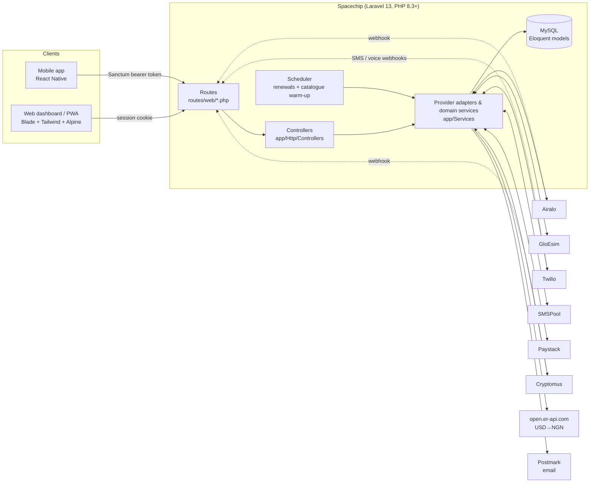
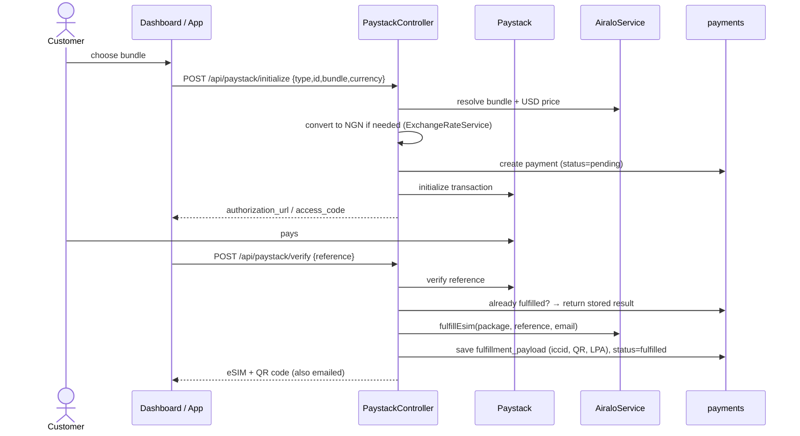

# Spacechip: Architecture & Design

> **Audience:** engineers working on this codebase.
> **Status:** describes the code as of the `refactor/architecture-cleanup` branch (November 2026).
> **Companion docs:** [`README.md`](README.md) (setup), [`docs/mobile_api.md`](docs/mobile_api.md) (mobile API contract), [`docs/ADMIN_CONSOLE.md`](docs/ADMIN_CONSOLE.md) (admin console), `cleanup.pdf` (what changed in the restructure).

---

## 1. What Spacechip is

Spacechip sells **connectivity products** to travellers and people who need a second number, from a web dashboard (installable PWA) and a React Native mobile app that share one backend.

| Product | What the customer gets | Upstream provider | Billing |
|---|---|---|---|
| **Travel eSIMs** | A data eSIM for a country/region, installed by QR code, plus top-ups | **Airalo** (catalogue + fulfilment). **GloEsim** is legacy: still synced for older eSIMs | One-off |
| **Virtual numbers** | A real phone number with an SMS/voice inbox and email forwarding | **Twilio** | Monthly subscription |
| **Social numbers (one-time)** | A number that receives a single verification code (~10 min) for WhatsApp, Telegram, etc. | **SMSPool** | One-off, auto-refunded if no code arrives |
| **Social numbers (rental)** | A dedicated verification number kept for 30-day periods | **SMSPool** (rentals) | Monthly, auto-renewed |

Customers pay by **card (Paystack, NGN or USD)**, by **crypto (Cryptomus, web only)**, or from a **USD wallet** they top up with Paystack.

---

## 2. System context



---

## 3. Tech stack

| Layer | Choice | Notes |
|---|---|---|
| Runtime | PHP 8.3+, Laravel 13 | |
| Auth | Laravel session auth (Breeze, customised) + **Sanctum** personal access tokens | Web registration uses an emailed 6-digit OTP; Google/Facebook via Socialite |
| Database | MySQL in production, SQLite in tests (`:memory:`) | |
| Mail | Postmark | |
| Front end | Blade, Tailwind CSS 3, Alpine.js 3, vanilla JS | See section 10 for how CSS is delivered |
| QR codes | `bacon/bacon-qr-code` (SVG) | eSIM activation codes |
| Hosting | Hostinger over SSH, deployed by GitHub Actions on push to `main` | See section 12 |

---

## 4. Codebase map

```
app/
├── Console/Commands/          Scheduled renewals (virtual numbers, social rentals)
├── Http/
│   ├── Controllers/
│   │   ├── Admin/             Admin console (Dashboard, Users, Payments, Wallet,
│   │   │                      Numbers, Platform) + Airalo diagnostics
│   │   ├── Api/               JSON endpoints shared by dashboard and mobile app
│   │   │   ├── AuthController            mobile register/OTP/login/logout/me
│   │   │   ├── MobileDiscoveryController /api/mobile/health, /api/mobile/endpoints
│   │   │   ├── MyEsimController          the user's eSIMs + provider sync
│   │   │   ├── SocialNumberController    one-time SMSPool activations
│   │   │   ├── SocialRentalController    monthly SMSPool rentals
│   │   │   ├── VirtualNumberController   Twilio numbers, checkout, inbox
│   │   │   └── WalletController          balance, ledger, top-up, pay-from-wallet
│   │   ├── Auth/              Browser auth (Breeze + OTP + Socialite)
│   │   ├── Esim/              Catalogue + checkout pages
│   │   ├── Payments/          Paystack and Cryptomus eSIM payments
│   │   ├── VirtualNumbers/    Dashboard pages for virtual numbers
│   │   ├── Webhooks/          Airalo, Twilio, Cryptomus callbacks
│   │   ├── DashboardController.php
│   │   └── ProfileController.php
│   ├── Middleware/            EnsureAdmin, PreventBackHistory
│   └── Requests/              Form requests (auth, profile)
├── Mail/                      OtpVerificationMail
├── Models/                    Eloquent models (section 7)
├── Services/                  One class per upstream provider + domain services
├── Support/                   SocialNumbers (SMSPool presenters/refunds), Money
└── View/Components/           AppLayout, GuestLayout, PublicLayout

config/
├── services.php               Credentials + tuning per provider
├── wallet.php                 Deposit limits, minimum balance
├── virtual_numbers.php        Default currency/price for new countries
└── admin.php                  ADMIN_EMAILS allow-list

routes/
├── web.php                    Pages; loads everything below
├── web/
│   ├── mobile-auth.php        /api/auth/*
│   ├── esims.php              catalogue, checkout, Paystack, Cryptomus, my-esims
│   ├── wallet.php             /api/wallet/*
│   ├── virtual-numbers.php    dashboard pages + /api/virtual-numbers/*
│   ├── social-numbers.php     /api/social-numbers/*, /api/social-rentals/*
│   ├── webhooks.php           provider callbacks
│   └── diagnostics.php        /debug/* (admin only)
├── admin.php                  admin console (/admin/*), audited + rate limited
├── auth.php                   Breeze browser auth routes
├── api.php                    stateless /api/mobile/* discovery
└── console.php                Scheduler + maintenance commands

resources/views/
├── partials/                  head-assets (icons, fonts, design system), tailwind (Vite or CDN)
├── layouts/                   app (signed-in), public (marketing), guest (auth)
├── landing, allassets, details, checkout, dashboard …   page templates
└── emails/, vendor/mail/      transactional email templates

public/css/spacechip-ui.css    Design-system foundation layer (section 10)
docs/mobile_api.md             Mobile API contract
tests/Feature/                 HTTP-level tests incl. PageSmokeTest
```

---

## 5. Architectural decisions

### 5.1 Layering

```
Route (URI, middleware, throttle)  →  Controller (HTTP in/out, orchestration)
                                   →  Service (one per provider; returns ['ok' => bool, …])
                                   →  Model (persistence)
```

* **Routes are a map, not logic.** Every route points at a controller method. No closures (except the framework's `/up` and `/storage/*`). This keeps `php artisan route:cache` safe and each file readable at a glance.
* **One route file per domain** under `routes/web/`, each opening with a header that explains the domain. Route *order* is significant where literal segments compete with wildcards (for example `/virtual-numbers/my` must precede `/virtual-numbers/{country}`), and the files say so.
* **Services wrap providers.** Each upstream API has exactly one adapter in `app/Services`. Adapters return arrays shaped `['ok' => true|false, 'status' => int, 'error' => string, 'json' => …]` instead of throwing, so controllers branch on `ok` and map failures to `422`/`502` responses. `tests/Feature/ApiErrorHandlingTest.php` pins this contract.
* **Domain services own invariants.** `WalletService` is the only code that changes `users.wallet_balance_minor`, and it does so inside a DB transaction with `lockForUpdate()` while writing a ledger row.

### 5.2 Why `/api/*` lives on the `web` middleware group

The same endpoints serve two clients:

* the **dashboard**, which calls them with its **session cookie** (and CSRF token), and
* the **mobile app**, which sends a **Sanctum bearer token**.

`auth:sanctum` accepts both, but only when the route has a session, which the `web` group provides. The routes are therefore loaded from `routes/web.php`. CSRF is exempted for the mobile/provider prefixes in `bootstrap/app.php`, while cookie-authenticated dashboard calls still send the token. `routes/api.php` holds only the stateless mobile discovery endpoints.

### 5.3 Configuration, never `env()` at runtime

Production runs `php artisan config:cache`, after which `env()` returns `null` outside `config/*.php`. All runtime settings are therefore read with `config()`. Feature-specific settings have their own files (`wallet.php`, `virtual_numbers.php`, `admin.php`). **Rule:** a new setting gets a config key first, then code reads the key.

### 5.4 Money

* All amounts are **integers in minor units** (`*_minor`): USD cents, NGN kobo. No floats are stored.
* The **wallet is USD**. Paystack may charge **NGN**; `ExchangeRateService::usdToNgn()` fetches a live rate (cached, with an optional markup), falling back to `ESIM_USD_TO_NGN_RATE`.
* Provider cost and sell price are stored separately on orders (`provider_cost_minor`, `sell_amount_minor`). Markups come from config (`SMSPOOL_MARKUP_MULTIPLIER`, `SMSPOOL_MINIMUM_SELL_MINOR`, …).

### 5.5 Idempotent fulfilment

Payment confirmation can arrive several times: the client polls `/status`, the user retries `/verify`, a webhook fires. Each payment flow therefore takes an atomic lock per reference (`Cache::lock`) and checks the persisted `payments.fulfillment_payload` **before** calling the provider, so an eSIM or number is provisioned once per payment reference. `tests/Feature/DuplicateOrderPreventionTest.php` covers this.

---

## 6. Core flows

### 6.1 Buying an eSIM by card



**Wallet** purchases (`POST /api/wallet/pay/esim`) follow the same path but debit `WalletService` instead of calling Paystack, and refund on fulfilment failure.

### 6.2 Virtual numbers (Twilio)

1. Browse countries (`/api/virtual-numbers/countries`, cached three days) and live numbers (`/available`).
2. Pay by Paystack (`/paystack/initialize` → `/verify`) or wallet (`/api/wallet/pay/virtual-number`).
3. The number is purchased on Twilio with SMS/voice webhooks pointing to `/api/twilio/*`.
4. Inbound SMS and voicemail are stored as `virtual_number_messages` and optionally forwarded by email.
5. `virtual-numbers:renew` (hourly) charges subscriptions whose period has ended, using the saved Paystack authorization or the wallet according to `billing_method`. Failures mark the subscription `past_due` and increment `renewal_failed_count`.

### 6.3 Social numbers (SMSPool)

* **One-time:** `buy` debits the wallet → the client polls `check/{id}` (SMSPool `getSms`) → the code is stored. `cancel`, `ban` and expiry refund the wallet once (`SocialNumbers::refundOrder`; guarded by `refunded_at` and never after a code has arrived). `try-another` refunds the old order and buys a replacement, refunding again if the provider cannot supply one.
* **Rental:** `quote` → `buy` (wallet), and the rental is **live on purchase** (`activate` is kept as a no-op for older app versions) → `sms`. `social-rentals:renew` (hourly) renews `auto_renew` rentals 2 days before the period ends by debiting the wallet; after 4 failed attempts past the paid period it marks the rental `expired`.

### 6.4 Authentication

| Client | Register | Login | Session |
|---|---|---|---|
| Web | `POST /register` → OTP emailed → `/verify-otp` → logged in | `/login` or Google/Facebook | Cookie |
| Mobile | `POST /api/auth/register` → `POST /api/auth/verify-otp` → **token issued** | `POST /api/auth/login` → token | `Authorization: Bearer` |

OTPs are generated in one place, `User::issueEmailOtp()` (6 digits, 10-minute expiry). Most product endpoints also require `verified`.

---

## 7. Data model

```mermaid
erDiagram
    users ||--o{ payments : makes
    users ||--o{ wallet_transactions : "ledger"
    users ||--o{ virtual_number_subscriptions : owns
    users ||--o{ social_number_orders : owns
    users ||--o{ social_number_rentals : owns
    payments ||--o{ wallet_transactions : "funds / refunds"
    payments ||--o| social_number_orders : "pays for"
    payments ||--o| social_number_rentals : "pays for"
    virtual_number_products ||--o{ virtual_number_subscriptions : "priced by"
    virtual_number_subscriptions ||--o{ virtual_number_messages : receives

    users { bigint id; string email; bool is_admin; bigint wallet_balance_minor; string email_otp }
    payments { bigint id; string provider; string provider_reference; string status; string asset_type; bigint amount_minor; json provider_payload; json fulfillment_payload }
    wallet_transactions { string direction; string action; bigint amount_minor; bigint balance_before_minor; bigint balance_after_minor; json meta }
    virtual_number_subscriptions { string status; string phone_number; string billing_method; timestamp current_period_end; int renewal_failed_count }
    social_number_orders { string status; string phone; string sms_code; bigint sell_amount_minor; timestamp refunded_at }
    social_number_rentals { string status; string phone; bool auto_renew; timestamp current_period_end; json sms_messages }
```

`payments` is the **universal purchase record** for every provider and product. `fulfillment_payload` holds what was delivered (ICCID, QR/LPA, number), and the "My eSIMs" view is derived from it (`MyEsimService`).

---

## 8. Background work

Scheduled in `routes/console.php` (the server cron must run `php artisan schedule:run` every minute):

| Command | Frequency | Purpose |
|---|---|---|
| `virtual-numbers:renew` | hourly | Charge due Twilio subscriptions |
| `social-rentals:renew` | hourly | Renew SMSPool rentals 2 days before expiry; expire after 4 failed attempts |
| `smspva:refund-legacy` | manual | One-off: close and refund open SMSPVA numbers/rentals after the SMSPool cutover (`--dry-run` first) |
| `airalo:sync-catalog` | hourly | Re-warm the Airalo country/region/search caches |
| `db:sqlite-to-mysql` | manual | One-off migration helper from the original SQLite DB |

---

## 9. Security model

* **AuthN:** session (web) or Sanctum token (mobile), with `verified` on product endpoints.
* **AuthZ:** ownership is checked in every controller that takes a model or ID (`user_id === Auth::id()`). Admin access goes through `EnsureAdmin` → `User::isAdmin()` (DB flag **or** `ADMIN_EMAILS`). `is_admin` is not mass-assignable.
* **Account & platform controls:** `EnsureAccountActive` signs out suspended users (`403 account_suspended` on the API); `EnforcePlatformSettings` applies admin-controlled maintenance mode, sign-up toggle and per-product purchase kill switches. Both run on every web and API request. Admin writes are audit-logged (`admin_audit_logs`).
* **Rate limits:** each route declares its own `throttle:N,M`. Money-moving endpoints sit at 10–20 per minute and OTP resend at 3 per 10 minutes.
* **Webhooks:** Twilio (`X-Twilio-Signature`) and Cryptomus (`sign`, `hash_equals`) are verified. **Airalo is not** (section 14).
* **Diagnostics:** `/debug/airalo-*` are admin-only.
* **Secrets:** only in `.env`, read via `config/*.php`. `.env` is git-ignored.

---

## 10. Front end & design system

### 10.1 Page families

| Layout | Used by | Notes |
|---|---|---|
| `layouts/app` (`<x-app-layout>`) | dashboard, virtual numbers, profile, admin | Tailwind + Alpine, navigation bar |
| `layouts/public` (`<x-public-layout>`) | help, terms, privacy, contact, eSIM guide | Marketing chrome |
| `layouts/guest` (`<x-guest-layout>`) | login, register, OTP, password reset | Centred auth card |
| Stand-alone | landing, allassets, details, checkout, cryptomus-return | Hand-written CSS per page |

Every page includes **`partials/head-assets`** (icons, manifest, fonts, design system). Layout pages also include **`partials/tailwind`**, which serves the compiled Vite bundle when `public/build` exists and otherwise falls back to the Tailwind Play CDN plus the Alpine CDN build.

### 10.2 Design language

`public/css/spacechip-ui.css` is the foundation layer. It is a plain static file, so it needs no build step. Principles:

1. **Clarity:** system typography (SF Pro on Apple devices, Instrument Sans elsewhere), tightened heading tracking, balanced line wraps, tabular figures for money.
2. **Deference:** the brand coral/teal wash sits at reduced intensity so content and actions lead. Weights are capped at bold.
3. **Depth:** translucent "materials" (`saturate(180%) blur(20px)`) and two-layer shadows (`--sc-shadow-1…3`).
4. **Respect:** visible `:focus-visible` rings, `prefers-reduced-motion` support, 16px inputs on phones (no iOS zoom), tactile press feedback, safe-area-aware PWA banner.

Tokens (`--sc-*`) cover colour, radius, elevation, motion and an 8-pt spacing scale. **New UI should use the tokens** rather than new hex values.

Brand: green `#1f7a1f` on black, white and gray, with light, dark and system themes.

### 10.3 Motion & logo

`public/js/spacechip-ui.js` (deferred, every page) is a small, dependency-free runtime:

| Feature | How it works |
|---|---|
| **Logo** | No web splash (the mobile app keeps one). The wordmark is `partials/brand-wordmark` (inline SVG, "Space" in `currentColor`, "chip" `#D86C54`); favicons, PWA icons and `public/brand/*` are generated with the mobile repo's `scripts/generate-brand-assets.swift`, so web and app share one source. |
| **Reveal** | Cards (any class `card` or `*-card`) and key sections fade and rise in with a 55 ms stagger as they enter the viewport. A `MutationObserver` gives cards rendered later by page scripts a lighter entrance. Classes are removed after the animation so page hover and transition styles take over. |
| **Page transitions** | Cross-document View Transitions (`@view-transition`). The nav and tab bar are named so they stay put while content cross-fades. Unsupported browsers navigate normally. |
| **Count-up** | `[data-sc-countup]` animates numeric changes (the wallet balance). |

All of it respects `prefers-reduced-motion`. `html.sc-preload` holds the body for one tick so entrances start from a clean frame (failsafe 1.5 s).

**Page scripts.** Each interactive page loads its own plain script from `public/js/`, cache-busted with `?v=filemtime`:

| Script | Page |
|---|---|
| `landing.js` | Landing page |
| `allassets.js` | All destinations |
| `asset-details.js` | eSIM details |
| `dashboard.js` | Dashboard |
| `virtual-numbers-index.js`, `-country.js`, `-my.js` | Virtual-number pages |

Server values reach a script through a `<script type="application/json" id="…Config">` block (or `window.SPACECHIP_INITIAL_ESIMS` on the dashboard), never through Blade inside the JS. The checkout pages still use inline scripts because they embed many server values.

### 10.4 Navigation

`layouts/navigation.blade.php` is the single nav for every signed-in page: a glass bar with a segmented control (eSIMs · Numbers · Admin), an account menu, and an iOS-style **floating tab bar** on phones. It uses namespaced `.scn-*` classes so page CSS (for example the dashboard's `.hidden{display:none!important}`) can't break it.

### 10.5 Front-end pitfalls this codebase has hit

* **`1fr` grid columns don't shrink** below their content. Use `minmax(0, 1fr)`, or a long row widens the page and mobile browsers zoom out.
* **Flex children default to `min-width: auto`.** The app layout's `<main>` children get `min-width: 0` globally.
* **`backdrop-filter`, `filter` and `transform` create a containing block** for `position: fixed` descendants. Never put a modal inside a blurred card.
* **Page `<style>` blocks:** later rules win. Several dashboard "mobile" rules were silently overridden by desktop rules declared after them, so scope desktop rules with `@media (min-width: 641px)`.

---

## 11. Configuration reference

| Key(s) | Purpose |
|---|---|
| `ADMIN_EMAILS` | Comma-separated admin allow-list |
| `AIRALO_*` | eSIM catalogue & fulfilment (`AIRALO_SANDBOX=true` for testing) |
| `GLOESIM_*` | Legacy eSIM provider (sync only) |
| `TWILIO_*` | Virtual numbers + webhook URLs |
| `SMSPOOL_*` | Social numbers, including markup and minimum sell price (admin Settings can override pricing at runtime) |
| `FIVESIM_*` | Legacy 5SIM account, only monitored on the admin Providers page |
| `PAYSTACK_*` | Card payments. `PAYSTACK_CURRENCY` is `NGN` or `USD`; `PAYSTACK_OWNER_EMAIL` optionally overrides the payer email |
| `CRYPTOMUS_*` | Crypto payments (web only) |
| `ESIM_USD_TO_NGN_RATE`, `EXCHANGE_RATE_*`, `ESIM_EXCHANGE_RATE_MARKUP_MULTIPLIER` | FX source, cache time, fallback and markup |
| `WALLET_MIN_DEPOSIT_USD`, `WALLET_MAX_DEPOSIT_USD`, `WALLET_MIN_BALANCE_MINOR` | Wallet limits |
| `VIRTUAL_NUMBER_DEFAULT_CURRENCY`, `VIRTUAL_NUMBER_DEFAULT_MONTHLY_AMOUNT_MINOR`, `VIRTUAL_NUMBER_USD_TO_NGN_RATE` | Virtual number defaults |
| `GOOGLE_*`, `FACEBOOK_*` | Social login |
| `POSTMARK_TOKEN`, `MAIL_*` | Email |

`.env.example` lists every key.

---

## 12. Delivery

`.github/workflows/deploy.yml` deploys **on every push to `main`**: SSH to Hostinger → `git pull` → `composer install --no-dev` → `migrate --force` → `config:cache`, `route:cache`, `view:cache`.

Consequences:

* `main` is production. Work on branches and merge deliberately.
* Anything that breaks under cached config or routes (`env()` in app code, closures referencing functions defined in route files) breaks production. Both patterns have been removed. Keep it that way.
* Front-end assets are **not** built on deploy (see section 14).

---

## 13. Testing

```bash
composer test          # clears config cache, then runs the suite
php artisan test --filter PageSmokeTest
```

| Suite | Covers |
|---|---|
| `Auth/*` | Browser auth flows, including OTP registration |
| `PageSmokeTest` | Every page that does not need a live provider renders; admin gating; `isAdmin()`; mass-assignment guard |
| `ApiErrorHandlingTest` | Provider adapters degrade to `ok:false` instead of throwing |
| `DuplicateOrderPreventionTest` | Payment fulfilment is idempotent |
| `GloEsimPackageFilteringTest` | Package filtering rules |

Tests use in-memory SQLite and `Http::fake()`. They never call real providers.

---

## 14. Known gaps & roadmap

Listed in priority order. None of these were changed in the restructure, because each one changes behaviour and deserves its own reviewed change.

1. **Verify Airalo webhooks.** `POST /api/airalo/webhook` accepts unsigned requests. Today the only effect is a "low data" email to the eSIM owner, but it should verify Airalo's signature before acting.
2. **Build front-end assets in CI.** Add `npm ci && npm run build` to the deploy (or build in Actions and upload `public/build`). `partials/tailwind` will then switch to the ~9 KB gzipped compiled CSS automatically and drop the in-browser Tailwind compiler.
3. **Form Requests** for the JSON endpoints, replacing inline `$request->validate()` and manual input parsing.
4. **Split `dashboard.blade.php`** into Blade components per panel (eSIMs, wallet, numbers, social). Its script already lives in `public/js/dashboard.js`; the next step is ES modules under `resources/js` built by Vite.
5. **Retire GloEsim** once no active eSIMs depend on it (`GloEsimService`, ~1,250 lines, is kept for sync only).

Done in the November 2026 cleanup: shared eSIM fulfilment (`App\Services\EsimFulfillment`) used by the Paystack, Cryptomus and wallet paths; `App\Services\PaystackService`; every inline HTML email replaced by `App\Mail\NoticeMail` (`resources/views/emails/notice.blade.php`); `App\Services\VirtualNumberCatalog` for number pricing; payment-flow tests (`EsimPaymentFlowsTest`, `VirtualNumberFlowsTest`, `VirtualNumberRenewalTest`, `MyEsimsTest`); and `Http::preventStrayRequests()` in the base `TestCase` so tests can never reach a live provider.

---

## 15. Conventions

* **Controllers:** one per domain, grouped by audience (`Api/`, `Webhooks/`, `Payments/`, `Admin/`). New endpoints go in the matching `routes/web/*.php` file with an explicit `throttle`.
* **Names:** every route is named `<domain>.<action>` (`wallet.pay.esim`, `social-numbers.buy`).
* **Money:** integers in minor units, suffix `_minor`. Never floats in storage.
* **Provider calls:** only through `app/Services` (including Paystack, via `PaystackService`).
* **Emails:** `App\Mail\NoticeMail` (one branded template); add a named constructor for new notices rather than building HTML.
* **Config:** never `env()` outside `config/`.
* **Style:** `./vendor/bin/pint` before committing (rules in `pint.json`).
